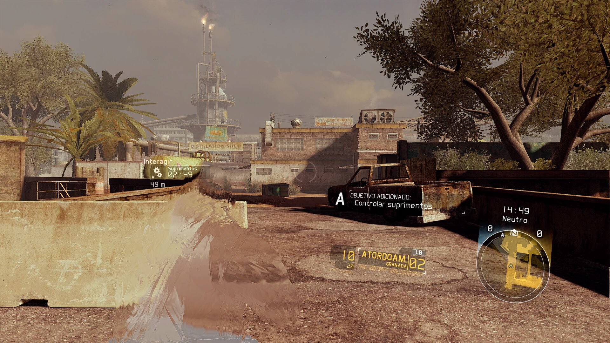
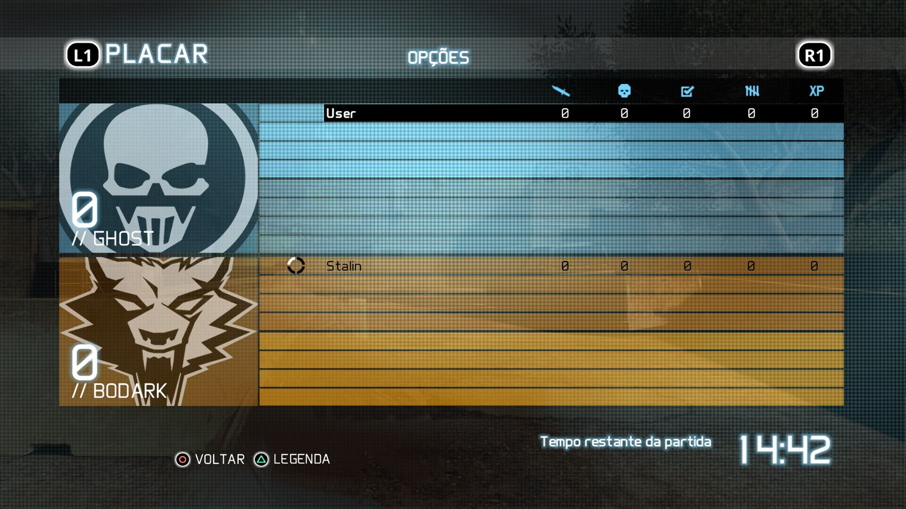
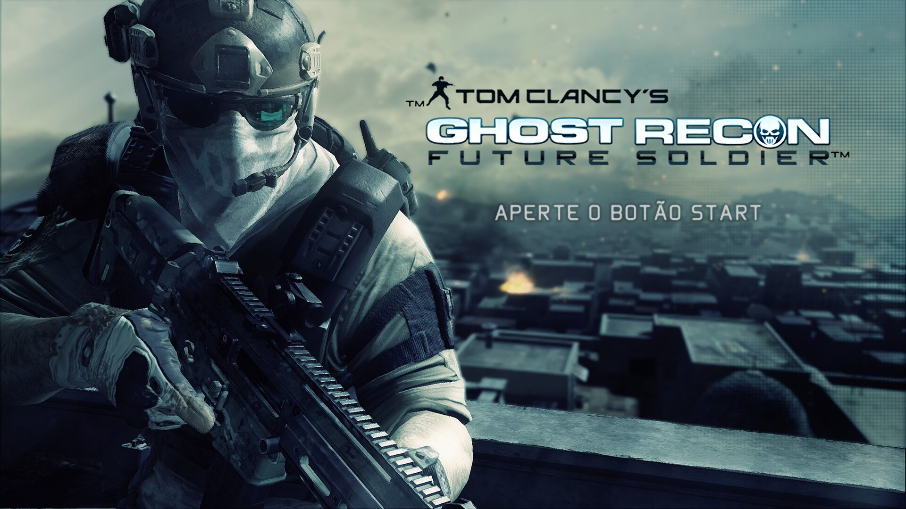

# Ghost Recon: Future Soldier — PS5 native port

An unofficial fan port of Tom Clancy's Ghost Recon: Future Soldier (Xbox 360)
to the PS5, recompiled with [ReXGlue](https://github.com/rexglue/rexglue-sdk)
and its PS5 layer. Not affiliated with Ubisoft, Sony or Microsoft; no game files
are included — you need your own copy. See [CREDITS.md](CREDITS.md).

| PS5 and PC in one match through the relay | Title screen |
|---|---|
|  |  |

**Download:** [latest release](../../releases/latest) · **Discord:** https://discord.gg/pmK6zDYQSP

## What the port adds

- PS5-style trophies (the UPLAY menu entry), PT/EN texts, FSR upscaling.
- DualSense button prompts and controller diagrams: `assets/ps5/textures/*.patch`
  hold only the redrawn DXT blocks, written over the player's own textures
  when the game loads them (`tools/make_texture_patches.py`).
- Shaders from earlier play shipped in the release (`shaders/`), merged into
  the player's own storage at startup and compiled before the menu
  (`src/shader_seed.cpp`), so they don't stutter the first time.
- System Link over the LAN or through a relay server ("Online (VPS)"), picked
  in the multiplayer menu (`src/connection_menu.cpp`).
- System Link progression: class XP and ranks, kept per console on the
  server too (`src/ai_hooks.cpp`, `src/progression_hooks.cpp`,
  `src/player_account.cpp`), with online bans.
- No Uplay: passport and linked account always on.
- Ghost Feed news, donors and a "help keep me active" screen with a QR code,
  from the server (`src/news_hooks.cpp`, `src/support_screen.cpp`).

## Building

Needs the rexglue-ps5 SDK (ReXGlue with the PS5 layer and this project's
changes), the ps5-plume-triangle toolchain and the code generated from your
own `default.xex` and `AICLASS_X360_F.xex` into `generated/`
(`tools/ps5_patch_generated.py` adapts it).

    cmake --preset ... -B out/ps5     # with cmake/ps5-toolchain.cmake
    ninja -C out/ps5 grfs
    tools/ps5_package.sh out/ps5 <ps5-plume-triangle checkout>

The app folder lands in `out/ps5/ps5-app/PPSA95210`; copy your game files to
its `assets/` and set `grfs.toml` (`system_link_relay`, `news_url`).

## Server

`tools/news_server.py` (news, donors, support screen, players and bans, with
an admin page) and the relay `system_link_relay.py` of rexglue-ps5, both
plain Python 3.
